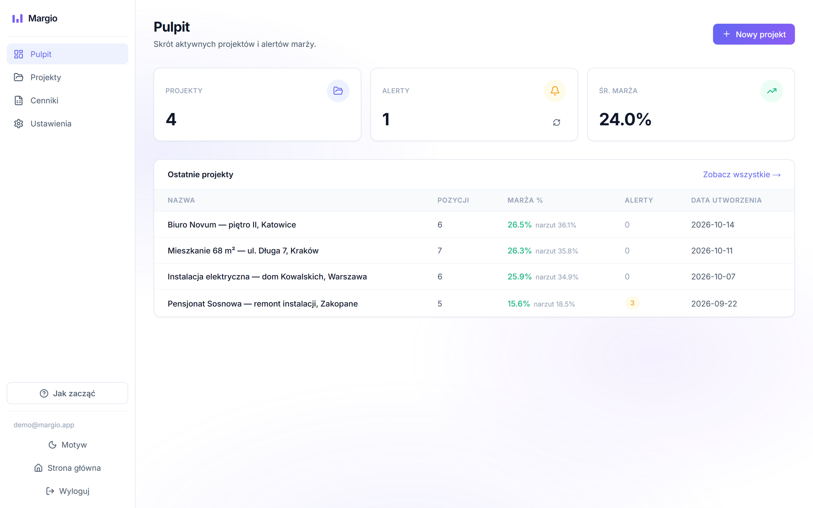

# Margio

**B2B SaaS that matches construction cost-estimate items to wholesaler price lists and protects the contractor's margin in real time.**

Electricians, plumbers and construction firms bid on jobs using cost estimates full of messy material names. Getting a real price means matching each line against several wholesaler price lists, by hand, in Excel, for hours, with mistakes that quietly eat the margin. Margio automates that matching and flags every line where the margin drops below target.



> 🛠 **Status:** engineering thesis project and a commercial product in active development.
>
> 🚧 **Actively built and tested.** The app is continuously improved, so some features are still evolving and parts of the live demo may be rough around the edges.
>
> 🔒 **Closed-source.** The code is private. This repository is a technical case study.
>
> ▶️ **Live demo:** [margiotest.vercel.app](https://margiotest.vercel.app) &nbsp;·&nbsp; demo login: `demo@margio.app` / `demodemo` (a guided "Jak zacząć" tour opens after login)
>
> 💬 Happy to walk through the code and architecture in an interview.

---

## What it does

- **Ingest price lists** from file upload (CSV / XLSX) or a supplier URL, with **automatic column mapping**. The app figures out which column is SKU, EAN, name, price or unit, even when every supplier formats differently.
- **Match estimate items to catalog products** through a layered pipeline (exact, then parameter extraction, then semantic search, then optional LLM re-ranking) with a **confidence score** on every match.
- **Human-in-the-loop** for uncertain matches, with an AI suggestion when the LLM layer is on. The user's decision is saved to a per-company dictionary, which is **guarded against wrong clicks** so one mistake cannot spread to every future quote.
- **Unit conversion.** A kosztorys line in metres or pieces is priced correctly against a catalog sold per drum, roll or pack of 100. Mismatched units never get auto-accepted.
- **Margin or markup.** Each company picks which one is the headline figure, and the other is always shown alongside.
- **Real-time margin alerts.** When a supplier price change pushes a line below the target, the affected projects are flagged.
- **Supplier optimization.** Split a basket across suppliers to minimize total cost.
- **Export** supplier-split quotes to **Excel and PDF** (in Polish, for the end client), with orders rounded up to whole supplier packages.
- **Project snapshots and diffs.** Freeze a quote and see exactly what changed when prices move.
- **Multi-tenant.** Every company's data is fully isolated, enforced by an automated test.

---

## Architecture at a glance

Margio is a **Next.js (App Router) + TypeScript** application backed by **PostgreSQL (Supabase, PG 17 + pgvector)**, deployed on **Vercel**. There is no ORM. Data access is **raw parameterized SQL** through `node-postgres`, kept in typed query functions. Authentication is a **custom JWT + bcrypt** implementation.

The interesting part is the **matching engine**, a deterministic-first, AI-last pipeline. See **[ARCHITECTURE.md](ARCHITECTURE.md)** for the full breakdown. The short version:

```
Estimate item
   │
   ▼
Layer 0  Normalization       parse CSV/XLSX, locale-aware numbers, clean EAN/SKU, unify units
   ▼
Layer 1  Exact Match         EAN → SKU → company dictionary (trust-checked) → normalized name
   ▼
Layer 2  Parameter Extract   technical params (cross-sections, diameters, volume), no AI
   ▼
Layer 3  Semantic Search     pgvector similarity over catalog embeddings
   ▼
Confidence Aggregator        scores the candidates and routes the item:
   ├─ high     → AUTO_ACCEPT
   ├─ medium   → Layer 4: LLM re-ranking (never sees prices) → auto-accept or review with a suggestion
   └─ low      → Human-in-the-loop → company dictionary
   ▼
Unit gate                    auto-accept with an unconvertible unit → human review
```

**Why this order matters:** the cheap, deterministic layers resolve the easy majority of items first, so the expensive, fuzzy layers only run on what is genuinely ambiguous. It is faster, cheaper and far more predictable than throwing every line at a vector search or an LLM.

---

## Engineering highlights

**Hybrid matching, not "just embeddings."**
A pure semantic search confuses a 3×2.5mm² cable with a 3×1.5mm² one. They look similar, they are technically different, and a wrong match corrupts a real quote. So exact identifiers (EAN/SKU) and extracted technical parameters run before vector search, and semantic similarity only breaks ties within the same parameter class.

**Confidence-based routing with a human fallback.**
Every item gets a confidence score that decides its path: auto-accept, re-rank or human review. Uncertain items never fail silently. They surface to the user, and each manual decision is written back to a per-company dictionary so the same item resolves automatically next time. Matching also skips archived and superseded price lists and picks deterministically (newest valid entry first), so re-running a match gives stable, explainable results rather than shifting under the user.

**Margin integrity: contract price vs live price.**
A quote's margin is calculated on the **contract price** the contractor committed to, while alerts fire on **today's live price**. These are deliberately two separate cost bases. Approving a quote locks in the margin the user agreed to, and a separate live-cost check still warns "if you bought this today, you'd be below your threshold." Collapsing them into one number would either freeze the margin and silence drift alerts, or let an agreed quote's numbers move under the contractor's feet. Keeping them split is what makes both the committed margin and the drift alert trustworthy.

**Strict multi-tenant isolation, enforced by a test.**
Every data-access function takes `tenantId`, and it is **only ever read from the verified JWT session, never from the request body.** A test scans every SQL string in the codebase (100+ queries) and fails the test suite on a data query without a tenant filter, so the rule cannot quietly erode. The Supabase public API roles are locked out of the database entirely (privileges revoked, RLS default-deny).

**An LLM layer that is measured, not just added.**
Layer 4 sends only ambiguous mid-confidence items to the model, with the top 5 candidates and **no prices**: the candidate type has no price field, so the type system rules it out. The answer is a strict JSON schema where the choice is an enum of the shown candidates or `null`, so the model cannot invent an option. Any error, timeout or invalid answer falls back to human review. The routing decision is a single side-effect-free function, `decideMatch()`, shared by the production route and an evaluation script, so the benchmark exercises exactly the production code. The labelled set has 57 estimate-style lines, a third of them traps (`B16` vs `B20`, `3×1.5` vs `3×2.5`, products not in the catalog), and the script reports accuracy, false auto-accepts, cost and latency before vs after the LLM, plus a confidence-threshold sweep so the auto-accept cutoff is chosen from data rather than guessed. The layer is off by default and toggled by an environment variable.

**A company dictionary that cannot be poisoned by one click.**
A manual decision used to become a rule that auto-accepted every future identical line. Now a human-sourced entry is trusted only when its wording is close to the chosen product (trigram similarity) or the same choice was confirmed at least twice; otherwise the item goes back through the pipeline. Users can review and delete entries in settings.

**Units and numbers that real price lists actually use.**
Polish price lists write `1.234,56` and sell cable per 100 m drum. Numbers are parsed by locale (the last separator is the decimal one), `3x2,5` keeps its decimal comma instead of collapsing into a different cable, and pack sizes are read from product names so a line in metres is costed per metre, not per drum.

**Safe ingestion of untrusted input.**
Uploaded price lists are validated inside a file sandbox (type checks, size limits). URL imports are size-capped while streaming and refuse private and link-local addresses (SSRF). Heavy ingestion runs through a background job processor rather than blocking the request. Login and registration are rate-limited in the database, since serverless instances share no memory.

**Price-list dedup, snapshots and diffs.**
Migrations add deduplication, trigram indexing for fast fuzzy lookup, and project snapshots, so a quote can be frozen and diffed against live prices later.

---

## Tech stack

| Layer | Choice |
|---|---|
| Framework | Next.js 16 (App Router), React 19, TypeScript (strict) |
| Database | PostgreSQL 17 on Supabase, `pgvector`, `pg_trgm` |
| Data access | `node-postgres` (raw parameterized SQL, no ORM) |
| Auth | Custom JWT (`jose` / `jsonwebtoken`) + bcrypt, multi-tenant |
| AI | OpenAI embeddings (semantic search), LLM re-ranking with strict structured output (optional layer) |
| Files | `papaparse`, `xlsx`, `exceljs`, `@react-pdf/renderer` |
| Testing | Vitest (101 unit tests, incl. the tenant-filter guard), DB checks in rolled-back transactions |
| Deploy | Vercel |

---

## About

Built by **Bartłomiej Dobranowski**, Computer Science student.
Margio is my engineering thesis and a product I am developing toward launch.

- GitHub: [@xtfee](https://github.com/xtfee)
- LinkedIn: [bartlomiej-dobranowski](https://www.linkedin.com/in/bartlomiej-dobranowski/)
- Email: ecomdobranowski@gmail.com

*The source code is private. This repository documents the architecture and decisions. I am glad to walk through the actual codebase live.*
